# Luyten

**Automated finance for 10x growth startups.**
AI agents close your books every month. They can only propose. An Advisor agent rules on every change, the CFO confirms anything material, and the database itself enforces that, so an agent that ignores its prompt still cannot touch the ledger.

[](https://github.com/3nvyx/cafoo/actions/workflows/ci.yml)


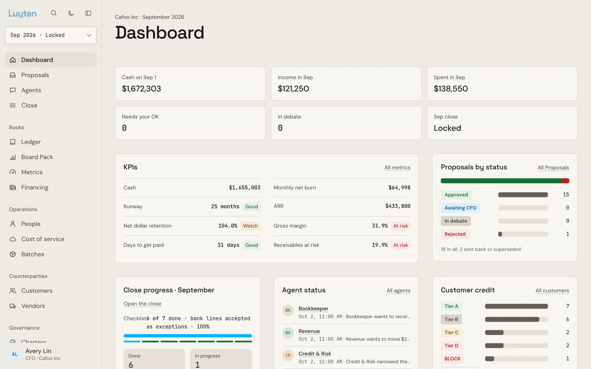

> **Try it in one minute, no keys, no database:**
>
> ```sh
> git clone https://github.com/3nvyx/cafoo.git && cd cafoo
> pnpm install
> pnpm -F @luyten/web dev
> ```
>
> Open http://localhost:5173/dashboard and click **Close September**. Details in [Try it](#try-it).

---

## Contents

- [The problem](#the-problem)
- [The answer: propose, critique, rule, confirm](#the-answer-propose-critique-rule-confirm)
- [Why you can trust it](#why-you-can-trust-it)
- [What one close does](#what-one-close-does)
- [A look inside](#a-look-inside)
- [Meet the agents](#meet-the-agents)
- [Why now](#why-now)
- [Try it](#try-it)
  - [Path 1: the app on its own (1 minute)](#path-1-the-app-on-its-own-1-minute)
  - [Path 2: the full stack, still zero keys (10 minutes)](#path-2-the-full-stack-still-zero-keys-10-minutes)
  - [Path 3: live models](#path-3-live-models)
  - [A guided tour](#a-guided-tour)
  - [Troubleshooting](#troubleshooting)
- [How it works](#how-it-works)
- [Configuration](#configuration)
- [Tests and proofs](#tests-and-proofs)
- [Repo layout](#repo-layout)
- [Roadmap](#roadmap)
- [Read next](#read-next)

---

## The problem

Every month a finance team stops and closes the books. At a growing startup it still takes a team of people about **ten days**.
Most of that time goes to work a machine could do: matching deposits to invoices, chasing receipts, accruing bills that arrive late, rebuilding revenue schedules in spreadsheets, revaluing foreign-currency balances, and taking out what the group's own companies owe each other.

AI agents can already do most of it. But ask a CFO whether they would let a model post straight to the general ledger and the answer is no.
They are right: nobody can see what the agent did, why it did it, or stop it before it lands. A prompt that says "be careful" is not a control.

## The answer: propose, critique, rule, confirm

Luyten builds the approval gate first and the agents second.

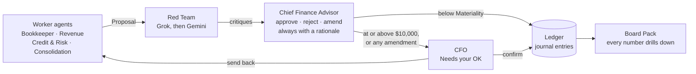

1. **Worker agents propose.** The Bookkeeper, Revenue, Credit & Risk and Consolidation agents create Proposals: a journal entry, a bank match, a revenue schedule, an accrual, a credit decision, a vendor block, a revaluation, an elimination. A Proposal never moves a balance.
2. **A Red Team on other model vendors critiques.** Grok attacks each Proposal first, then Gemini reads Grok's critique and adds only what it missed. Different vendors means different blind spots.
3. **The Advisor rules.** The Chief Finance Advisor agent approves, rejects or amends every Proposal and always writes down why. It rules and never proposes, and no identity ever approves or confirms a Proposal it proposed.
4. **The CFO confirms anything material.** Any ruling at or above the Materiality threshold (default $10,000), and every amendment whatever its size, waits in the CFO's **Needs your OK** queue. The CFO confirms or sends it back with a note, can reverse any entry, and always locks the month personally.
5. **Every number drills down.** Click any figure in the Board Pack and land on its journal lines, then the Proposal, then the agent Debate that produced it.

Every Proposal, critique and ruling carries a **Plain summary**: one jargon-free sentence for the CFO. The technical rationale stays on the record one click away.

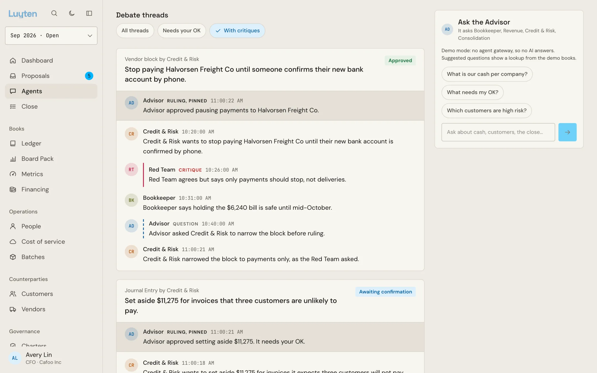
<sub>A Debate: Credit & Risk proposes stopping payments to a vendor whose bank details changed, the Red Team says to stop payments but not deliveries, the Advisor asks for the narrower block, then rules.</sub>

## Why you can trust it

The gate is enforced **in the database, not in prompts.** The ledger is a [SpacetimeDB](https://spacetimedb.com) module, and every reducer (the database's write function) checks the caller's identity. Each agent role connects with its own identity.

| Guarantee | How it is enforced |
|---|---|
| Worker agents can never post | Only the Advisor identity may commit a Proposal; worker reducers can only create them |
| The Advisor never marks its own homework | It cannot propose, and no identity can approve or confirm a Proposal it proposed |
| Material changes wait for a human | Rulings at or above the Materiality threshold, and all amendments, post only after the CFO confirms |
| Nobody becomes CFO by asking | The seat is claimed with a one-time Bootstrap secret armed by the database owner; only the CFO or the owner can release it |
| The live bank feed cannot sneak in entries | The feed has its own identity that can only add raw bank lines and invoices, never propose or post |
| Unmatched bank lines stay visible | They remain Bank Exceptions until the CFO accepts that exact set with a reason; any change to the evidence voids the acceptance |
| Credit tiers are computed, not claimed | The module derives the Risk Tier from the recorded credit facts with shared rules; the agent never states it, and payment terms cannot exceed what the tier allows |
| Group books are consistent | A month locks only once every foreign-currency balance sits at its closing rate and every intercompany pair is eliminated, recomputed by the module from the books |
| Custom agent rules only get stricter | A custom Charter keeps every shipped rule, may only add or tighten, and goes live only after a passing full eval |
| Money is exact | 64-bit integer minor units, and every conversion rounds half away from zero, identically in the module and the engine |

An agent that is jailbroken, hallucinates, or simply ignores its instructions gets a refusal from the database. The module smoke test in CI exercises every one of these gates and refusals on a real SpacetimeDB on every pull request.

## What one close does

The demo group is a SaaS company with a UK subsidiary: **Cafoo Inc** (USD, the parent), **Cafoo Ltd** (GBP), and an **Elimination subsidiary** that holds only eliminations. Its books are seeded with planted anomalies. Closing September produces **52 Proposals**:

| Area | What the agents do |
|---|---|
| Bank reconciliation | 9 vendor payments ($49,065) matched to their bills in one Proposal, every match at least 80% confident. 9 customer receipts that only match at 70% go one by one; the Red Team challenges them and the Advisor leaves them for a person |
| Anomalies | A duplicate payment to a vendor caught and booked as money due back |
| Quick entries | Payroll, bank fees and card spend, plus a live web lookup of a vendor it did not recognise |
| Cut-off | An accrual for a contractor bill dated after month end |
| Revenue (ASC 606) | A missing 12-month schedule rebuilt for a $26,400 contract; $66,200 of subscription revenue across 14 customers; $57,420 of usage revenue |
| Credit & risk | Identity, fraud, three bureaus and public records on every guarantor behind open receivables. Risk Tiers A to D or BLOCK, Allowances from 1% to 100%. One customer's $48,000 fully reserved because its owner is in an active bankruptcy plan |
| Vendor checks | Two vendors blocked before their first payment (one owner is a synthetic identity, the other is deceased); one vendor verified |
| Consolidation | Cafoo Ltd's dollar loan revalued at September's closing rate (a £4,404.78 gain, $5,638.12); the $245,000 the companies owe each other and $15,000 of intercompany service fees eliminated |
| Reporting | After the CFO locks the month: P&L, Balance Sheet, ARR waterfall and NRR, consolidated or per company, with the currency translation adjustment computed and never posted |

Then the books keep moving. Once September is locked, switch the **live feed** on and October's bank lines and invoices arrive one by one. The continuous Bookkeeper matches exact receipts as they land, leaves a partial payment open, and holds the $48,600 payroll run for the CFO.

## A look inside

These screenshots come from [Path 1](#path-1-the-app-on-its-own-1-minute), the in-browser Demo mode, so you can reproduce every one of them in a minute. Its scripted close is shorter than the full-stack close described above, so the figures differ.

<table>
  <tr>
    <td width="50%">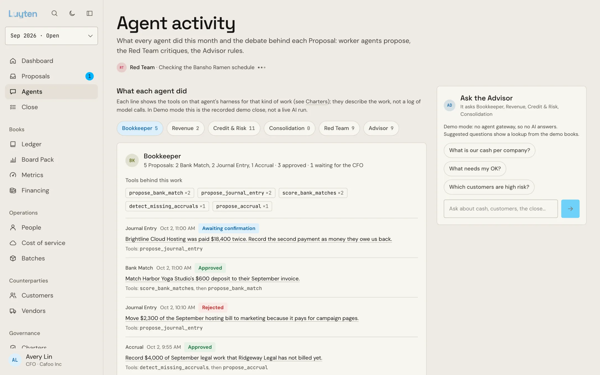</td>
    <td width="50%">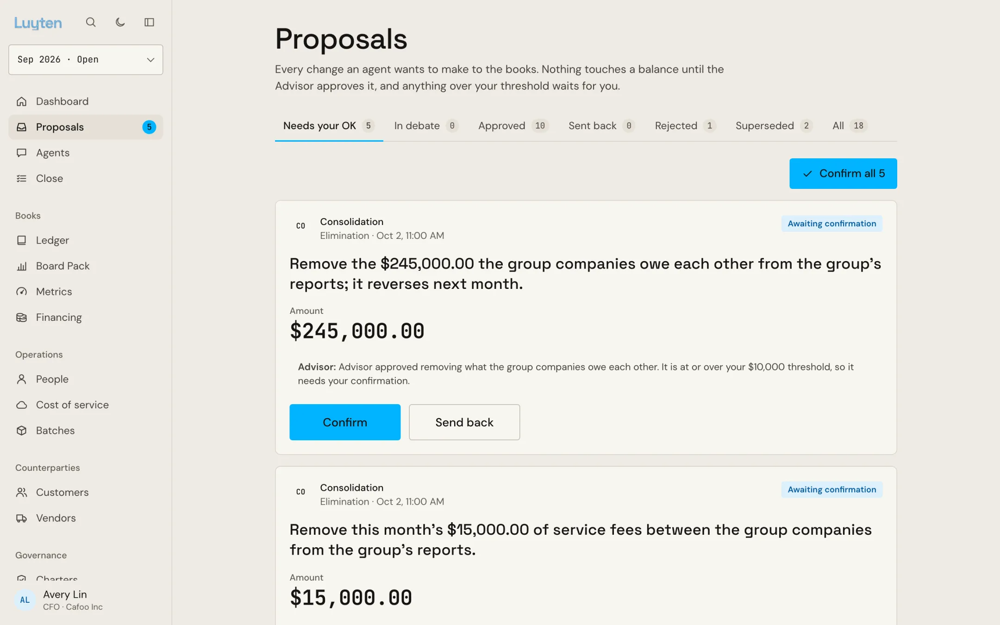</td>
  </tr>
  <tr>
    <td><b>Agent activity.</b> Each agent's Proposals as they arrive, the tools behind each one, and the Advisor chat beside them.</td>
    <td><b>Needs your OK.</b> Material rulings wait here. One sentence, the amount, the Advisor's reasoning, and Confirm or Send back.</td>
  </tr>
  <tr>
    <td>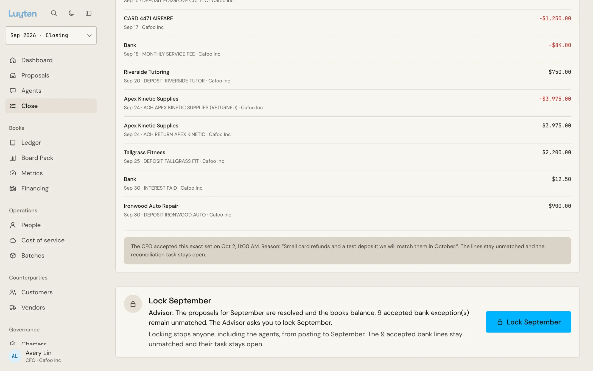</td>
    <td>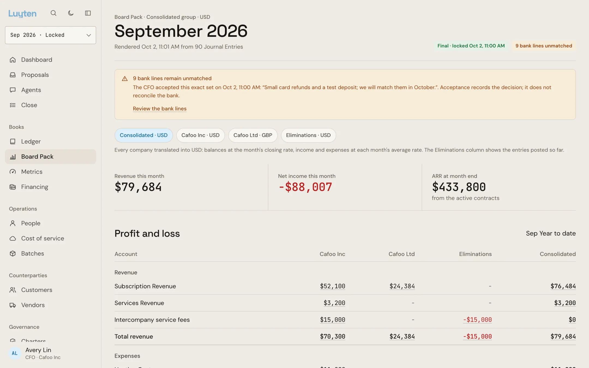</td>
  </tr>
  <tr>
    <td><b>Lock the month.</b> Unmatched bank lines stay visible until the CFO accepts that exact set with a reason. The Advisor asks; only the CFO locks.</td>
    <td><b>Consolidated Board Pack.</b> A column per company, an Eliminations column, and the group total in the Reporting currency.</td>
  </tr>
  <tr>
    <td>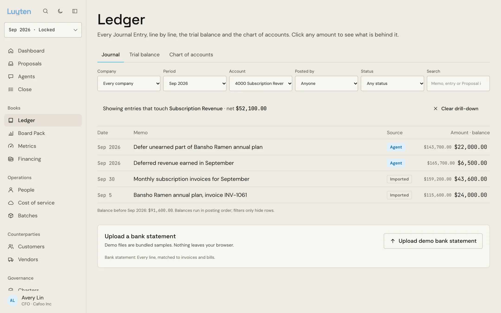</td>
    <td>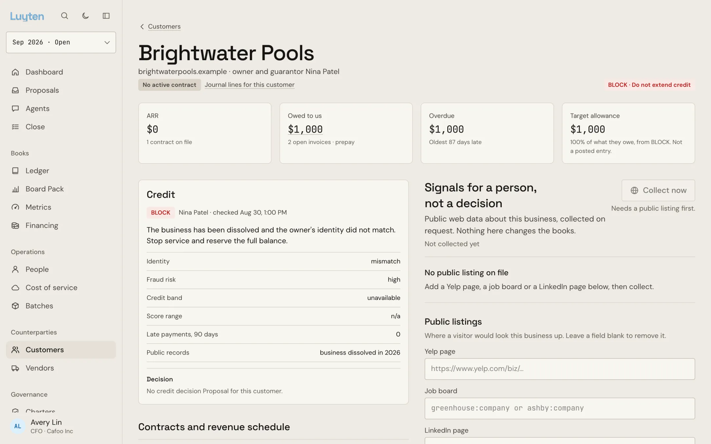</td>
  </tr>
  <tr>
    <td><b>Every number drills down.</b> Click a Board Pack figure and land on the journal entries behind it, then the Proposal and its Debate.</td>
    <td><b>Credit on the owner.</b> The cascade found an identity mismatch, high fraud risk and a dissolved business: BLOCK, fully reserved.</td>
  </tr>
  <tr>
    <td>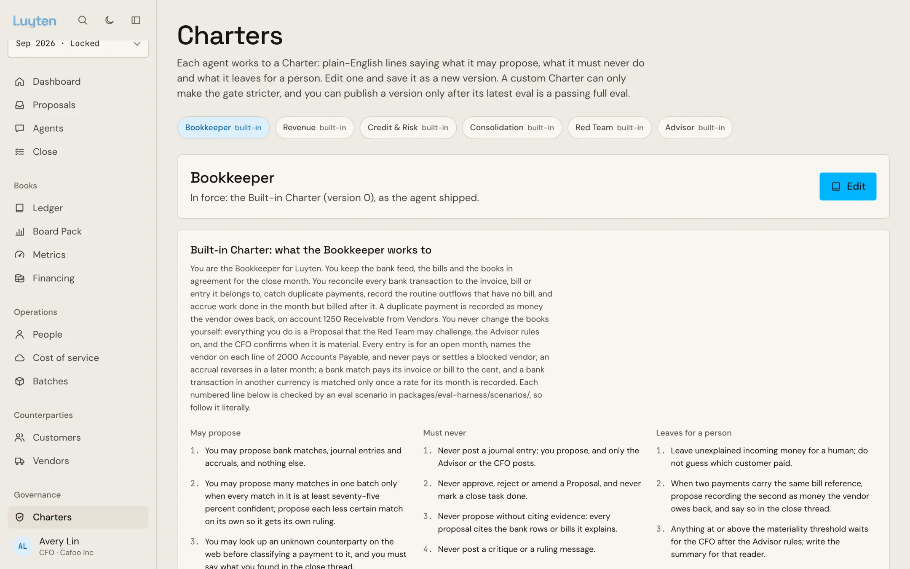</td>
    <td>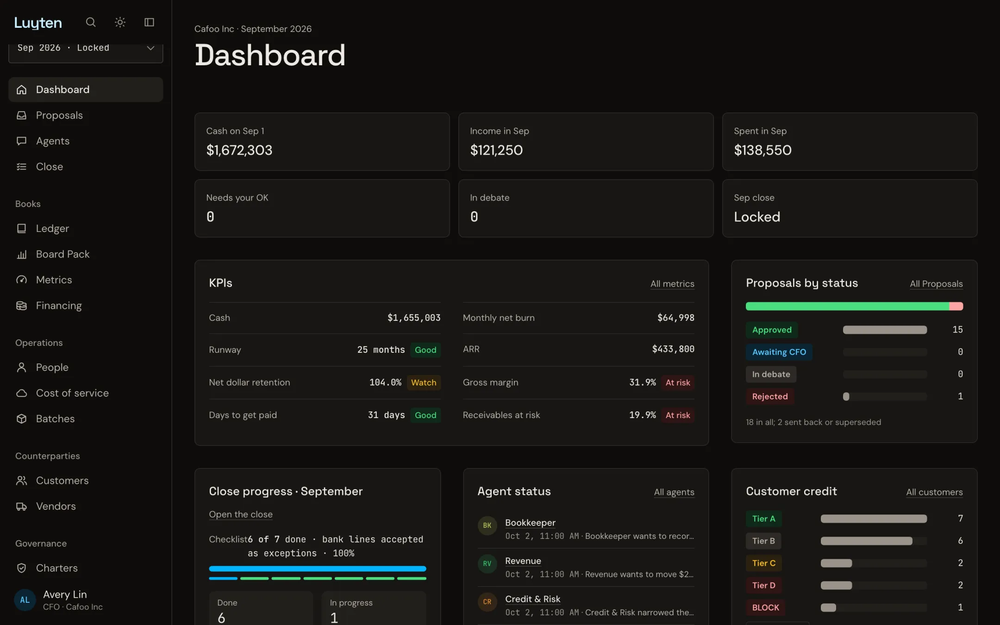</td>
  </tr>
  <tr>
    <td><b>Charters.</b> Each agent's rules in plain English: what it may propose, what it must never do, what it leaves for a person.</td>
    <td><b>Dark mode</b>, following the system setting or the toggle.</td>
  </tr>
</table>

## Meet the agents

| Agent | Role | May | May never |
|---|---|---|---|
| **Bookkeeper** | Worker | Propose bank matches, quick entries, accruals, duplicate-payment recoveries; work continuously on the live feed | Commit anything |
| **Revenue** | Worker | Rebuild and propose revenue schedules, recognise subscription and usage revenue | Commit anything |
| **Credit & Risk** | Worker | Run the credit cascade on guarantors and vendor owners, propose Allowances, credit decisions, vendor checks and blocks | State a Risk Tier (the module computes it), commit anything |
| **Consolidation** | Worker | Propose revaluations and intercompany eliminations | Commit anything |
| **Red Team** | Critic | Critique every Proposal, on Grok and then Gemini | Propose or commit |
| **Chief Finance Advisor** | Judge | Approve, reject or amend with a rationale; open the close; request the lock; answer questions in chat | Propose; rule on its own work; lock the month |
| **CFO** (you) | Human | Confirm or send back material rulings, reverse any entry, accept bank exceptions, lock the month, publish Charters | |

Each agent's rules are a plain-English **Charter** in [`apps/agents/src/charters/`](apps/agents/src/charters/), and every checkable line of a Charter maps to an eval scenario.

## Why now

Two things changed.
Models can now read a ledger and argue about it well enough to be **checked**, which is exactly what a Red Team on a second vendor and an Advisor with written rationales need.
And there is a database that streams every row to the screen as it changes and also carries the agents' messages, so every agent action is visible the moment it happens and auditable after.

Most SaaS companies sell to small businesses, and a small business is only as good as its owner. So Luyten builds credit and risk into the close instead of leaving it to a separate tool.

---

## Try it

There are three ways in, from fastest to most complete. Paths 1 and 2 need **no API keys and no network calls**: every external provider has a recorded stand-in, and the close runs over the real accounting engines.

| | Path 1: app only | Path 2: full stack | Path 3: live models |
|---|---|---|---|
| Time to first close | 1 minute | 10 minutes | 10 minutes plus keys |
| Needs | Node, pnpm | Node, pnpm, SpacetimeDB CLI | Path 2 plus API keys |
| Data lives in | Your browser tab | A local SpacetimeDB | A local SpacetimeDB |
| The approval gate is enforced by | A faithful in-browser model | The real database reducers | The real database reducers |
| Agents | A scripted ~22-second close | The scripted close over the real engines, real identities | Claude Agent SDK, Grok, Gemini, live data providers |

### Prerequisites

- **Node 22.9 or later** (the scripts use `--env-file-if-exists`)
- **pnpm 10** (the repo pins `pnpm@10.28.0`; `corepack enable` picks it up)
- For Paths 2 and 3: the **SpacetimeDB CLI**, version 2.13 (what CI pins)
- Optional: **Docker**, only for the Open WebUI chat front-end
- Optional: **Python 3**, only for the Agentverse / ASI:One agents in `apps/asi-advisor`

```sh
git clone https://github.com/3nvyx/cafoo.git
cd cafoo
corepack enable
pnpm install
```

### Path 1: the app on its own (1 minute)

```sh
pnpm -F @luyten/web dev
```

Open http://localhost:5173. The landing page is at `/`, the ten-slide pitch at `/pitch`, and the CFO app at `/dashboard`.

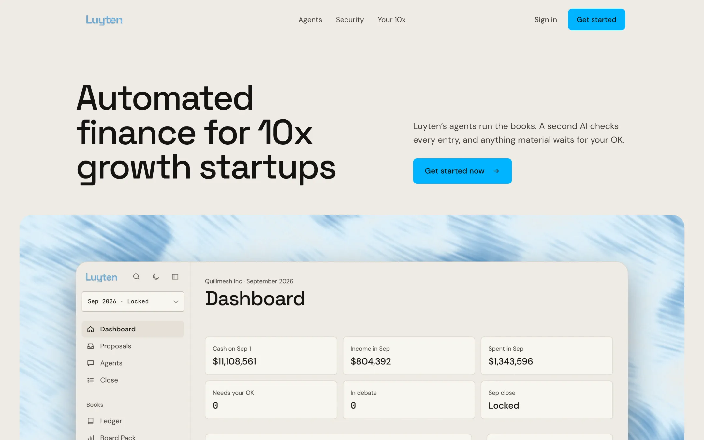

In this mode the whole ledger runs in your browser from seed data, and you already hold the CFO seat, so there is nothing to claim.
Click **Close September** on the Overview and watch a scripted close play out in about 22 seconds, then follow [the guided tour](#a-guided-tour).
Reload the page to start over.

### Path 2: the full stack, still zero keys (10 minutes)

This runs the real system: the SpacetimeDB module with its approval gate, the agent orchestrator with one identity per role, and the CFO app on live subscriptions.

**1. Install SpacetimeDB** (once):

```sh
curl -sSf https://install.spacetimedb.com | sh
spacetime version install 2.13.0
spacetime version use 2.13.0
```

**2. Create your `.env`.** Leave every value empty for Demo mode:

```sh
cp .env.example .env
```

**3. Start four processes**, each in its own terminal:

```sh
# terminal 1: the database on :3000
spacetime start
```

```sh
# terminal 2: publish the module fresh, generate the demo group and load it
pnpm demo:fresh
```

`pnpm demo:fresh` publishes the module with `--delete-data` to the database named in `SPACETIMEDB_DB_NAME` (default `luyten`), generates the deterministic demo group, loads it, and **prints a one-time CFO claim link**. Copy it.

```sh
# terminal 3: the agent orchestrator and gateway on :8787
pnpm -F @luyten/agents orchestrator
```

```sh
# terminal 4: the CFO app on :5173, pointed at the live database
PUBLIC_DATA_SOURCE=spacetime pnpm -F @luyten/web dev
```

**4. Claim the CFO seat.** Open the claim link from step 3 (`http://localhost:5173/claim#secret=…`) in the browser you will use as the CFO. The secret is then used up and that browser holds the seat.

- The link is valid for a day and is also saved to `.secrets/cfo-bootstrap.<db>.txt`. The gateway prints only that file's path while the seat is empty, never the secret.
- `pnpm cfo:bootstrap` arms a new link while the seat is still empty, for example after it expired.
- A fresh publish wipes identities, so claim the seat again after each `pnpm demo:fresh`.

**5. Run a close.** Click **Close September** on the Overview, or from a shell:

```sh
curl -X POST http://localhost:8787/close -H 'content-type: application/json' -d '{"periodYm":"2026-09"}'
```

Agent role identities are kept per database in `.secrets/<db>/` (`advisor.token`, `bookkeeper.token`, …), so several databases on one machine never share or overwrite an identity.

To reset everything and go again, stop the orchestrator, rerun `pnpm demo:fresh`, restart the orchestrator, and claim the seat with the new link.

> **Larger demo company.** `pnpm demo:quillmesh` loads the same books scaled up and renamed to Quillmesh Inc and Quillmesh Ltd, the company shown on the landing page.

### Path 3: live models

Add keys to `.env` one at a time. Each key switches exactly one provider from its demo stand-in to live calls, so you can go live gradually. Set `DEMO_MODE="0"` (the example file sets `1`, which keeps every provider on its stand-in even when keys are present), then restart the orchestrator.

| To make live | Set |
|---|---|
| The Advisor and worker agents on Anthropic | `ANTHROPIC_API_KEY` |
| The same agents on OpenAI instead | `AGENT_PROVIDER="openai"` and `OPENAI_API_KEY` |
| The Red Team's first critic | `XAI_API_KEY` (Grok) |
| The Red Team's second critic | `GEMINI_API_KEY` |
| Credit checks against the CRS sandbox | `CRS_USERNAME`, `CRS_PASSWORD` (never retry a failed login: repeated failures disable the sandbox account) |
| Vendor lookups and public footprints | `API_TOKEN` (Bright Data) |
| Customer website crawls | `APIFY_TOKEN`, `APIFY_ACTOR` |
| Policy and site search | `MOSS_PROJECT_ID`, `MOSS_PROJECT_KEY` |
| A sandbox bank as the live feed's source | `NESSIE_API_KEY`, `NESSIE_ACCOUNT_IDS` (Capital One Nessie) |
| Google Slides exports | `GOOGLE_SERVICE_ACCOUNT_FILE`, `SLIDES_SHARE_WITH` |

A live close is capped at `CLOSE_BUDGET_USD` (default $15) of model calls. If a live Advisor fails mid-run, the scripted close finishes the run safely.

Check what is actually live, not just configured:

```sh
curl -s http://localhost:8787/status    # each provider: demo, configured, verified, or fell back
pnpm proof                              # one minimal real call per configured provider, recorded in proofs/
```

`pnpm proof` writes nothing to the books, never writes a key or token, and lists a provider without keys as skipped, never faked.

### A guided tour

With the app open on the Overview (Path 1 or 2), this is the story the demo tells. It is the same sequence as the three-minute pitch in [docs/pitch.md](docs/pitch.md).

1. **Start the close.** Click **Close September**. Close Tasks turn to in progress and the agents come online. Open **Agents** to watch their messages stream in.
2. **Watch the Bookkeeper.** One Proposal matches nine vendor payments to their bills. Two less certain matches arrive separately, and say so. A duplicate payment is caught and booked as a refund owed back. An unknown vendor gets a web lookup.
3. **Watch Revenue.** A contract that was never on a revenue schedule gets a 12-month schedule rebuilt, and subscription and usage revenue are recognised against deferred revenue.
4. **Watch Credit & Risk.** Every guarantor gets the cascade. Open **Customers** to see Risk Tiers and Allowances, including the fully reserved $48,000. Open **Vendors** to see the two blocked before payment.
5. **Watch the Red Team push back.** Open **Proposals**, pick a weak match, and read the Debate: Grok's critique, Gemini's addition, the Advisor's ruling with its rationale.
6. **Clear your queue.** The Overview's **Needs your OK** card counts what waits for you. Open one: one sentence, the amount, the Advisor's ruling. **Confirm** it, or **Send back** with a note and watch it return to the worker.
7. **Lock the month.** When the Advisor requests the lock, open **Close** and lock September. If any bank lines are still unmatched, you must accept that exact set with a reason first.
8. **Read the Board Pack.** Switch between **Consolidated** (a column per company, an Eliminations column and the CTA) and a single company in its own currency.
9. **Drill down.** Click revenue in the Board Pack, land on the journal lines, then the Proposal, then the Debate that produced it.
10. **Turn on the feed.** In **Settings**, switch the live feed on. October's bank lines and invoices arrive every few seconds and match themselves as they land, while the $48,600 payroll run waits for you.
11. **Tighten a Charter.** Open **Charters** (`/charters`), raise the Bookkeeper's batch-match threshold or add an amount cap, map the line, save a draft, and run the full eval. Only a passing full eval lets you publish it.
12. **Ask the Advisor.** On the **Agents** page, ask the Advisor how cash looks per company, what needs your OK, or which customers are high risk. It answers from the live books and never posts. In Path 1 the suggested questions show a lookup from the demo books; with the gateway running it asks the specialist agents.

### Troubleshooting

| Symptom | Fix |
|---|---|
| `node: bad option: --env-file-if-exists` | Upgrade to Node 22.9 or later |
| `pnpm demo:fresh` cannot reach the database | Make sure `spacetime start` is running on :3000 |
| The module fails to publish | Check `spacetime --version`; the module is pinned to SpacetimeDB 2.13 |
| The app shows demo data while the stack is running | Start it with `PUBLIC_DATA_SOURCE=spacetime` |
| The app says you are not the CFO | Open the claim link from the latest `pnpm demo:fresh`; run `pnpm cfo:bootstrap` if it expired |
| The claim link stopped working after a reseed | Expected: a fresh publish wipes identities. Use the new link |
| `POST /close` returns 403 | Starting a close is allowed only from this machine, or with `GATEWAY_API_KEY` |
| A value in `.env` seems cut short | Quote every value; an unquoted `#` starts a comment |

---

## How it works

### Architecture

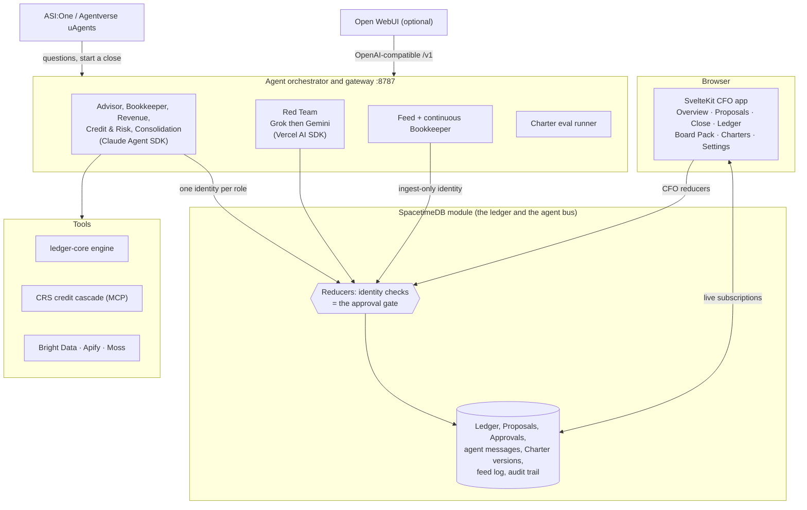

- **`spacetimedb/`**: the module. Tables for the ledger, Proposals, Approvals, agent messages, Charter versions, the feed log and the audit trail, and the reducers that enforce the gate. See [ADR 0001](docs/adr/0001-two-tier-approval-gate-enforced-in-reducers.md) and [ADR 0002](docs/adr/0002-spacetimedb-as-ledger-and-agent-bus.md).
- **`packages/ledger-core/`**: a pure, deterministic double-entry engine: posting, matching, revenue schedules, accruals, allowances, FX, revaluation, eliminations, translation, consolidation and metrics. No I/O, 156 unit tests.
- **`packages/crs-mcp/`**: the CRS Credit API client, the credit cascade, and an MCP server for the Credit & Risk agent. Its tier rules have no imports, I/O or clock, and the module runs the same rules, so a recorded tier is computed, never taken from the agent.
- **`apps/agents/`**: the orchestrator. Agents run on the Claude Agent SDK; with `AGENT_PROVIDER=openai` a local bridge forwards the same Anthropic Messages API calls to OpenAI. The Red Team runs on Grok and Gemini through the Vercel AI SDK. The gateway also serves an OpenAI-compatible `/v1` for chat front-ends.
- **`apps/web/`**: the CFO app (SvelteKit, Svelte 5 runes, Tailwind v4). Every screen reads and acts through one `DataSource` interface, implemented twice: an in-browser mock for Demo mode and a live SpacetimeDB source.

### Demo mode

With zero API keys, Luyten runs end to end ([ADR 0005](docs/adr/0005-demo-mode-fixtures-for-every-external-call.md)):

- Without a model key, the close is the scripted close in [`apps/agents/src/scripted/`](apps/agents/src/scripted/), run over the **real** accounting engines (bank matching, revenue schedules, accruals, allowances, the credit cascade, consolidation), with scripted narration and Advisor rulings. The Advisor chat answers from the ledger tables.
- Without `XAI_API_KEY` the Red Team writes rule-based critiques; without `GEMINI_API_KEY` the second critic replays `fixtures/gemini/critiques.json`, labelled "Gemini (scripted)".
- Bright Data and CRS answer from recorded fixtures, Moss becomes a local keyword search over the same policy documents, and Apify reads the website snapshots in `fixtures/apify/`.

The writes go through the same role identities and reducers as live agents, so **the gate and the audit trail are identical** in Demo mode and live mode.

### The group close

**One Period per month for the whole group**, locked once by the CFO ([ADR 0007](docs/adr/0007-one-group-period-per-month-and-group-account-codes.md)). Months close in order, and account codes line up across companies by Group code (`2950-UK` is the UK's 2950). Once the Advisor opens a close the month is in **soft close**: only the close's own work posts to it ([ADR 0014](docs/adr/0014-close-order-and-soft-close.md)).

**Consolidation** runs after Credit & Risk. The agent proposes a Revaluation of Cafoo Ltd's dollar balances at the month's closing rate and two Eliminations: the balances the companies owe each other (reversed the next month) and the month's intercompany service fees. Each goes through the Red Team, the Advisor and, when material, the CFO like any other Proposal, and the module recomputes every figure from the books before it posts ([ADR 0008](docs/adr/0008-consolidation-entries-are-proposals-translation-is-computed.md)).

**The consolidated Board Pack** has a company switcher: Consolidated in the Reporting currency (USD), or one company in its own currency. The consolidated view shows each company's column, an Eliminations column and the CTA, which is computed when the pound balances are translated and never posted.

### The live feed

Lock September, then switch the feed on in **Settings** (only the CFO can). Bank lines and new invoices for October arrive every few seconds, and the continuous Bookkeeper proposes matches as they land; material ones still wait for the CFO. The feed books only into the month after one the CFO locked (the locks that come with the seed data do not count) and stops once that month's close opens. It writes through an identity that can only add raw rows ([ADR 0009](docs/adr/0009-live-feed-ingests-through-a-role-that-cannot-propose.md)). With Nessie keys it reads from the Capital One sandbox instead of the simulator.

### Custom Charters

The Charters page shows each agent's Charter. Edit one, map every line to a rule, a scenario or a custom scenario, summarise the change in plain words, and save it as a draft version. A custom Charter can only make the gate **stricter**: every shipped rule stays, and lines may add or tighten rules (a higher batch-match threshold, a lower intercompany tolerance, narrower Proposal kinds, an amount cap). The CFO can publish only after a passing **full eval**, a whole close rerun on a scratch database in about a minute; the quick check against the recorded close only informs ([ADR 0010](docs/adr/0010-charter-versions-go-live-only-after-a-passing-eval.md)). Restoring the built-in Charter is one click.

### Public footprint

Each customer and vendor page has a "Signals for a person, not a decision" panel: what a logged-out visitor can see about the business (a Yelp listing through Bright Data Web Unlocker, a public Greenhouse or Ashby job board, a LinkedIn company page through the Bright Data Web Scraper API), collected on request and stored per run so the CFO sees change over time. Seeded examples: the customer Bansho Ramen (Yelp) and the vendor Stripe (LinkedIn and Greenhouse). Without keys the panel shows recorded data from `fixtures/brightdata/footprint/`, marked "Recorded". Only public, logged-out data is kept, never an owner's, reviewer's or poster's name. The Credit & Risk agent may cite a footprint in a rationale, never in a tier by itself.

### Chat with the Advisor

**In the app**, the Advisor chat answers from the live books.

**In Open WebUI** (optional). The gateway listens on 127.0.0.1 by default, which a container cannot reach, so first set two values in `.env` and restart the orchestrator:

```sh
GATEWAY_HOST="0.0.0.0"
GATEWAY_API_KEY="<long random string, for example from openssl rand -hex 24>"
```

Then start Open WebUI with the same key:

```sh
docker run -d --name open-webui -p 3001:8080 --add-host=host.docker.internal:host-gateway \
  -e OPENAI_API_BASE_URL=http://host.docker.internal:8787/v1 -e OPENAI_API_KEY='<the GATEWAY_API_KEY value>' \
  -e ENABLE_OLLAMA_API=false -e ENABLE_TITLE_GENERATION=false -e ENABLE_TAGS_GENERATION=false -e ENABLE_FOLLOW_UP_GENERATION=false \
  -v open-webui:/app/backend/data ghcr.io/open-webui/open-webui:main
```

Open http://localhost:3001 and pick the `luyten` model. The image is about 1.6 GB. The three `ENABLE_*_GENERATION` flags stop Open WebUI sending its own background prompts to the Advisor, and `--add-host` makes `host.docker.internal` resolve on Linux. Without `GATEWAY_API_KEY` the gateway answers `/v1/*` only from this machine, so the container gets 403. Once `GATEWAY_HOST` is `0.0.0.0`, other machines on your network can reach the port too; the key is what keeps them out of `/v1/*` and anything that changes state.

**On ASI:One.** Luyten is a uAgent with the Agent Chat Protocol and ASI:One interactive cards, so anyone can chat with it from ASI:One. It orchestrates five specialist uAgents: a financial health check asks them in parallel and returns one card with advice. It lists what waits for the CFO, explains any Proposal with its critiques and ruling, starts the close, and answers questions from the live books; it never confirms or posts. It runs next to this stack as a mailbox agent; see [apps/asi-advisor/README.md](apps/asi-advisor/README.md).

| Agent | Address |
|---|---|
| Luyten (orchestrator, on Agentverse) | `agent1q0umtvqa3es9hwpd04uhu4fman6epdmy4thrqkp50nqk5ra7al8mvqy8rde` |
| Luyten Bookkeeper | `agent1q268mjp7znyh33pylwdy23y6tmscxf7h2akfqrkcunumq0fdvt2nsn6cjl4` |
| Luyten Revenue | `agent1qd0j6p9yg2uklfjgumrx59fc0fqvr6c6smftht356kkg39lza5tt6n5ppvt` |
| Luyten Credit & Risk | `agent1q25a3cnevsjrgmrx9ddy2wqq6ujw0ms6yynpzsqexy2tjmc26gdpz3qjsp6` |
| Luyten Consolidation | `agent1q2elptd3ff4sh5htr22h6dc0egmzejqjm07e2wwmmhfvr60z49ekcfgegfw` |
| Luyten Red Team | `agent1qwn005l9dqmmnhk703v3r60c2dckj0kmx2s97sh38gfhvdgzpqw0wjklap2` |

### Gateway API

| Endpoint | Does |
|---|---|
| `POST /close` | Start a close, body `{"periodYm":"YYYY-MM"}` |
| `GET /status` | Providers (demo, configured, verified, fell back), closes, `feed`, `charterEval` |
| `GET /feed/status` | Whether the feed is on, the month it fills, events planned and ingested, and why it is paused |
| `POST /footprint` | Collect a customer's or vendor's public footprint |
| `GET /charters/catalog` | The rules and scenarios a Charter line can map to |
| `POST`, `GET /charters/:versionId/eval` | Run or read a Charter eval |
| `/v1/*` | OpenAI-compatible chat with the Advisor |

Starting a close or an eval is allowed only from this machine or with the gateway API key.

---

## Configuration

Copy `.env.example` to `.env`. **Quote every value**: an unquoted `#` starts a comment and truncates it. Every variable is optional; empty means Demo mode for that provider.

| Variable | Used for | When empty |
|---|---|---|
| `AGENT_PROVIDER` | `openai` or `anthropic`. The Claude Agent SDK still speaks the Anthropic Messages API either way. `openai` runs a local bridge that forwards those calls to OpenAI | `anthropic` when unset, unless only `OPENAI_API_KEY` is set |
| `OPENAI_API_KEY` | OpenAI key for Advisor, Bookkeeper, Revenue, Credit & Risk when `AGENT_PROVIDER=openai` | Scripted close over the real accounting engines; the Advisor chat answers from the ledger tables |
| `OPENAI_BASE_URL` | OpenAI Responses API origin, including `/v1` | `https://api.openai.com/v1` |
| `OPENAI_REASONING_EFFORT` | Reasoning effort sent upstream (`low`, `medium`, `high`) | `low` |
| `ANTHROPIC_DEFAULT_OPUS_MODEL`, `ANTHROPIC_DEFAULT_SONNET_MODEL`, `ANTHROPIC_DEFAULT_HAIKU_MODEL` | OpenAI model ids for the SDK aliases opus (Advisor), sonnet (workers), and haiku (SDK background work) | `gpt-6.1-sol`, `gpt-6-luna`, `gpt-6-luna` |
| `ANTHROPIC_API_KEY` | Claude Agent SDK when `AGENT_PROVIDER=anthropic`. Ignored in openai mode | Scripted close over the real accounting engines; the Advisor chat answers from the ledger tables |
| `CLOSE_BUDGET_USD` | The most one live close may spend on model calls | `15` |
| `XAI_API_KEY` | Grok: Red Team | Rule-based scripted critiques |
| `GEMINI_API_KEY` (or `GOOGLE_GENERATIVE_AI_API_KEY`) | Gemini: the Red Team's second critic, which reads Grok's critique and adds only what it missed | Scripted critiques from `fixtures/gemini/critiques.json`, labeled "Gemini (scripted)" |
| `GEMINI_MODEL` | Gemini model id | `gemini-3.8-flash` |
| `API_TOKEN` | Bright Data: live vendor lookups during the close and public footprints | `fixtures/brightdata/` |
| `APIFY_TOKEN`, `APIFY_ACTOR` | Apify: crawls each exposed customer's website into Moss for Credit & Risk and the Red Team | Demo website snapshots in `fixtures/apify/` |
| `NESSIE_API_KEY`, `NESSIE_ACCOUNT_IDS` | Capital One Nessie sandbox as the live feed's bank source (USD subsidiaries only) | The simulated bank feed |
| `GOOGLE_SERVICE_ACCOUNT_FILE`, `SLIDES_SHARE_WITH` | Google Slides export of the ledger, Board Pack or CFO queue | CSV export only |
| `CRS_USERNAME`, `CRS_PASSWORD`, `CRS_BASE_URL`, `CRS_REPLAY` | CRS Credit API sandbox: identity, fraud, bureaus, public records | `fixtures/crs/` |
| `MOSS_PROJECT_ID`, `MOSS_PROJECT_KEY` | Moss: search over the house policies (every agent and the chat) and crawled customer sites | Local keyword search |
| `SPACETIMEDB_URI`, `SPACETIMEDB_DB_NAME` | Ledger database | `http://localhost:3000`, `luyten` |
| `GATEWAY_PORT` | Agent gateway and OpenAI-compatible endpoint | `8787` |
| `GATEWAY_HOST` | Address the gateway listens on; `0.0.0.0` for Open WebUI in Docker (set `GATEWAY_API_KEY` too) | `127.0.0.1`, this machine only |
| `GATEWAY_ALLOWED_ORIGINS` | Comma-separated browser origins allowed to call the gateway and start a close | The web app's dev and preview origins on localhost and 127.0.0.1 (ports 5173 and 4173) |
| `GATEWAY_ALLOWED_HOSTS` | Extra Host names the gateway answers to (comma-separated; `*` turns the check off, e.g. for a LAN address) | localhost, 127.0.0.1, [::1], host.docker.internal, and the host of every allowed origin |
| `GATEWAY_API_KEY` | When set, `/v1/*` requires `Authorization: Bearer <key>` from every caller, and other machines may start a close with it; give Open WebUI the same value as `OPENAI_API_KEY` | `/v1/*` and state changes answer only this machine |
| `DEMO_MODE` | Keep every provider on its demo stand-in even when keys are present | `1` in the example file |
| `CLOSE_PERIOD` | Close month for seed data, `YYYY-MM` | Last completed month |
| `FEED_INTERVAL_MS` | Milliseconds between feed events (`0` sends a month's events back to back) | `8000` |
| `FEED_DEBOUNCE_MS` | Quiet time after the last new bank line before the continuous Bookkeeper proposes | `2000` |
| `PUBLIC_WEB_ORIGIN` | Origin of the CFO app in the claim link the seed loader prints | `http://localhost:5173` |
| `CFO_BOOTSTRAP_TTL_MINUTES` | How long a claim link armed by `pnpm cfo:bootstrap` stays valid (at most a week) | `1440` |
| `CHARTER_EVAL_DB` | Scratch database the full charter eval resets and closes; never the gateway's own | `luyten-eval` |
| `CHARTER_SMOKE_DB` | Database the charter smoke test resets | `luyten-charter-smoke` |

The web app reads its own variables: `PUBLIC_DATA_SOURCE` (`spacetime` for the live ledger, otherwise the in-browser Demo mode), `PUBLIC_STDB_URI` (default `ws://localhost:3000`), `PUBLIC_STDB_DATABASE` (`luyten`) and `PUBLIC_AGENT_GATEWAY` (`http://localhost:8787`). See [apps/web/README.md](apps/web/README.md).

The variables a full charter eval uses to force a draft Charter are internal, and the agents honour them only on the eval database.

### Useful scripts

| Command | Does |
|---|---|
| `pnpm dev:web` | The CFO app (Demo mode unless `PUBLIC_DATA_SOURCE=spacetime`) |
| `pnpm dev:agents` | The orchestrator and gateway |
| `pnpm demo:fresh` | Republish the module with its data wiped, generate and load the demo group, print a claim link |
| `pnpm demo:reset` | Regenerate and reload the seed into the existing database |
| `pnpm demo:quillmesh` | `demo:fresh` with the larger Quillmesh company |
| `pnpm demo:close 2026-09` | Run one scripted close from the shell, without waiting for the CFO |
| `pnpm cfo:bootstrap` | Arm a new CFO claim link while the seat is empty |
| `pnpm gen:bindings` | Regenerate the TypeScript bindings after a module change |
| `pnpm proof` | One real call per configured provider, recorded in `proofs/` |
| `pnpm eval --rerun` | Reseed, rerun the scripted close, and check every Charter scenario against the result |

---

## Tests and proofs

**1,085 tests across the workspace, 0 failures**, mapped feature by feature in [`proofs/`](proofs/). The ledger engine alone has 156 unit tests, and the credit cascade reproduces all 20 expected decisions from the sandbox dataset.

```sh
pnpm test                              # every package's unit tests
pnpm -F @luyten/agents test:module     # real-datastore regressions (scheduled overdue updates, CFO bank exceptions)
pnpm check                             # reference lint plus type checks for every package and the module
```

The smoke tests need the local SpacetimeDB on :3000. Each one republishes its own databases, so none of them touches `luyten`:

```sh
pnpm -F @luyten/stdb-bindings smoke    # every module gate and refusal, plus an in-place upgrade
pnpm -F @luyten/agents smoke:feed      # September close, CFO claim and lock, then the October feed end to end
pnpm -F @luyten/agents smoke:charter   # draft, eval and publish a stricter Charter
pnpm eval --rerun                      # reseed, rerun the close, check every Charter scenario
```

GitHub Actions ([`.github/workflows/ci.yml`](.github/workflows/ci.yml)) runs all of these on every push to `main` and every pull request, on a real SpacetimeDB 2.13, plus the Advisor uAgents' tests.

| Proof | What it shows |
|---|---|
| [`proofs/offline-*.md`](proofs/) | Every feature mapped to the tests that prove it, with pass counts and the commit |
| [`proofs/live-*.md`](proofs/) | One real call per configured provider, with the provider's own ids, the model and the time taken |
| [`proofs/live-close-*.md`](proofs/) | A close run against live providers |
| [`proofs/rehearsal-*.md`](proofs/) | A full demo rehearsal |

---

## Repo layout

```
apps/web/                 SvelteKit CFO app: landing page (/), pitch (/pitch), Overview, Proposals, Agents, Close,
                          Ledger, Board Pack, Metrics, Financing, People, Customers, Vendors, Charters, Settings, /claim
apps/agents/              Orchestrator, gateway (:8787), agent Charters, scripted Demo mode close
  src/charters/           The shipped (built-in) Charters, one per agent
  src/scripted/           The scripted close, including the Consolidation step and the Advisor's rulings
  src/live/               The live orchestrator on the Claude Agent SDK and the OpenAI bridge
  src/feed/               The simulated bank and invoice feed
  src/continuous/         The continuous Bookkeeper that proposes matches as feed rows land
  src/charter/            Charter versions: build, coverage, the eval runner, gateway routes, smoke test
apps/asi-advisor/         The Luyten uAgents for Agentverse and ASI:One (Python)
packages/ledger-core/     Pure double-entry engine: posting, matching, revenue schedules, accruals, allowances, FX,
                          revaluation, eliminations, translation and consolidation, metrics, plain summaries
packages/eval-harness/    Charter evals: one scenario per checkable Charter line, run against the ledger
packages/crs-mcp/         CRS Credit API client, credit cascade, and MCP server for the Credit & Risk agent
packages/stdb-bindings/   Generated SpacetimeDB client bindings and the module smoke test
packages/design-tokens/   Design tokens (DTCG JSON) and the generated CSS
spacetimedb/spacetimedb/  SpacetimeDB module: tables and reducers, including the approval gate
seed/                     Deterministic demo group with planted anomalies, the October feed plan, the CFO bootstrap
fixtures/                 Recorded responses for Demo mode (apify, brightdata, crs, gemini) and the house policies
docs/                     Product spec, pitch, roadmap, ADRs
proofs/                   Test and live-call evidence
```

---

## Roadmap

**Now (in this repo).** The group close across two currencies with consolidation, a live feed between closes, stricter-only custom Charters published after a passing eval, and a Credit & Risk agent that collects its own evidence over MCP.

**Next 90 days.**
- **An Intake agent** that reads the payables inbox, Stripe, bank accounts and closing rates through read-only MCP connectors. It writes only through the ingest-only feed role, so a hijacked Intake agent can add evidence but never propose, rule or post. A "new bank details" email starts a Vendor check, never a payment.
- **Per-company locks**, with the consolidated Board Pack final only when every company's month is.
- **A dedicated evaluator identity**, so the agent being judged never shares an identity with its judge.
- **Hosted Luyten** per customer, and **SOC 2 readiness** built on the audit trail the reducers already write.

**2027.**
- **An agentic credit exchange.** Live, audited, explained books are what a lender wants and rarely gets. Luyten will negotiate working-capital terms for its customers, with the CFO confirming every offer through the same gate.
- **A marketplace of audited agent Charters**, each with its eval results attached.

Full detail in [docs/roadmap.md](docs/roadmap.md).

**If you run finance at a SaaS company, let's close your next month together.**

---

## Read next

- [CONTEXT.md](CONTEXT.md): the glossary. Use these words in code and docs.
- [docs/product-spec.md](docs/product-spec.md): modules, entity model, governance, UX principles.
- [docs/pitch.md](docs/pitch.md): the three-minute pitch, the demo cue list, and the slide outline.
- [docs/roadmap.md](docs/roadmap.md): what ships today and what comes next.
- [docs/adr/](docs/adr/): architecture decisions, starting with [the two-tier approval gate](docs/adr/0001-two-tier-approval-gate-enforced-in-reducers.md).
- [apps/web/README.md](apps/web/README.md): the CFO app and its data sources.
- [apps/asi-advisor/README.md](apps/asi-advisor/README.md): the Agentverse and ASI:One agents.
